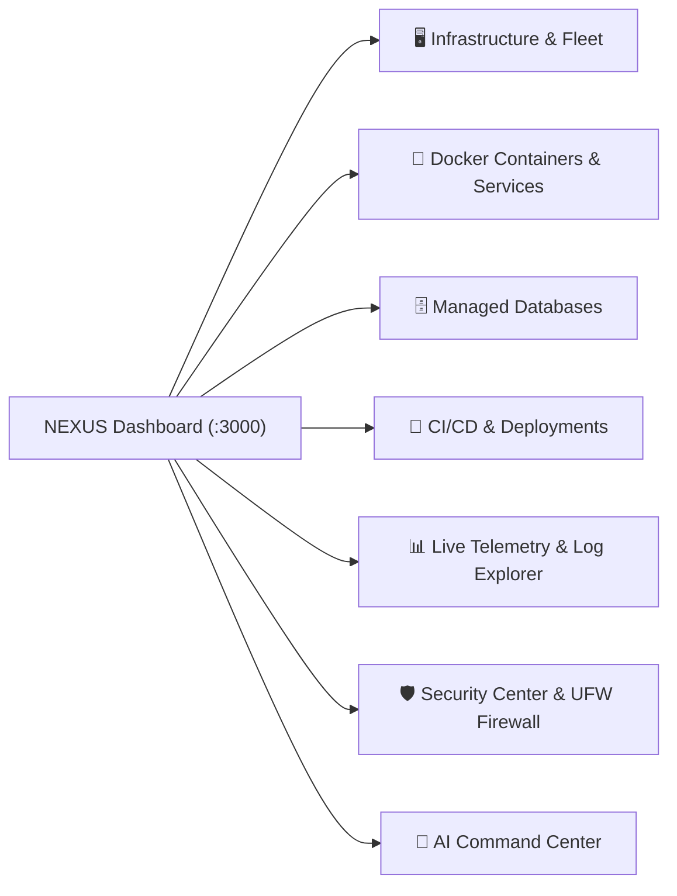
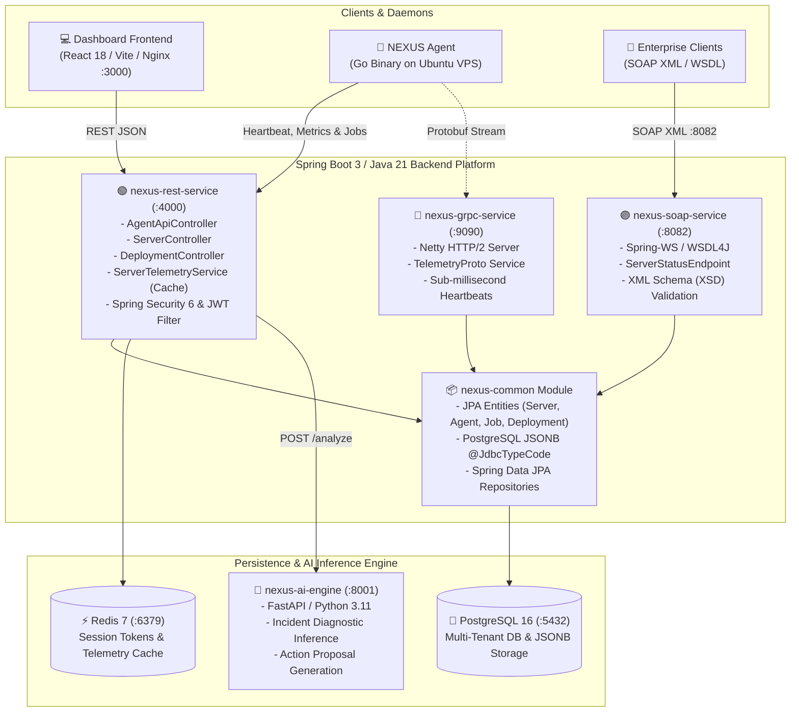
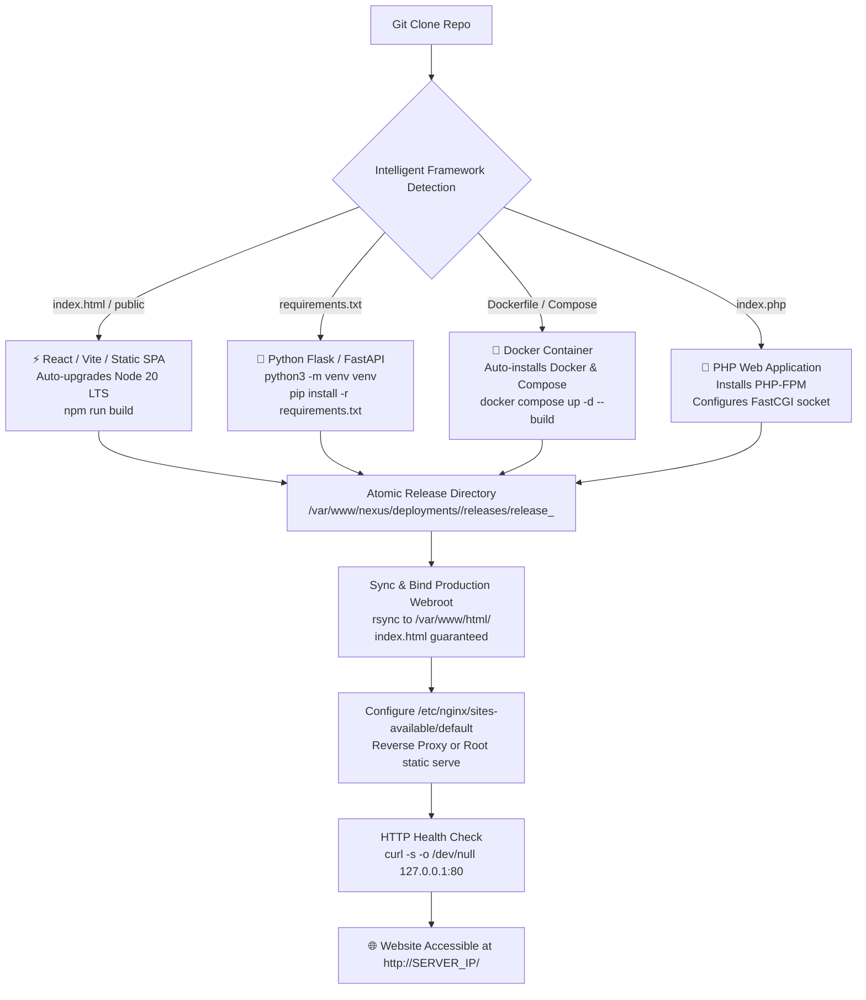

<div align="center">

# 🌐 NEXUS AI — Enterprise Linux VPS & Cloud Infrastructure Management Platform

**AI-Driven Autonomous Linux Server Orchestration, Multi-Protocol Microservices, Real-Time Telemetry & Universal Web Deployment Engine**

[](https://www.docker.com/)
[](https://spring.io/projects/spring-boot)
[](https://openjdk.org/)
[](https://go.dev/)
[](https://react.dev/)
[](https://fastapi.tiangolo.com/)
[](https://www.postgresql.org/)
[](https://redis.io/)

</div>

---

## 📋 Table of Contents
- [🌟 Platform Overview](#-platform-overview)
- [🗺️ Complete Platform Walkthrough](#️-complete-platform-walkthrough)
- [🏗️ In-Depth Backend & Microservices Architecture](#️-in-depth-backend--microservices-architecture)
- [🚀 NEXUS Node Agent (Go Daemon) & 24/7 Server Setup](#-nexus-node-agent-go-daemon--247-server-setup)
- [🌐 Universal Web Deployment Engine (Zero-Config)](#-universal-web-deployment-engine-zero-config)
- [🛡️ Security Center & Host Firewall Orchestration](#️-security-center--host-firewall-orchestration)
- [📊 Real-Time Observability & Telemetry Guardian](#-real-time-observability--telemetry-guardian)
- [🧠 AI Diagnostic Engine & Human-in-the-Loop Remediation](#-ai-diagnostic-engine--human-in-the-loop-remediation)
- [⚡ Quick Start with Docker](#-quick-start-with-docker)
- [🧪 Real-World Testing with VirtualBox or Cloud VPS](#-real-world-testing-with-virtualbox-or-cloud-vps)
- [📡 Complete API & Multi-Protocol Endpoints Catalog](#-complete-api--multi-protocol-endpoints-catalog)
- [📂 Directory Structure](#-directory-structure)

---

## 🌟 Platform Overview

**NEXUS AI** is an enterprise-grade cloud control plane designed to monitor, secure, deploy, and remediate applications across fleets of distributed Linux VPS nodes (Ubuntu Server, Debian, Hetzner, AWS, DigitalOcean, or local VirtualBox VMs).

Unlike traditional panels (cPanel, Portainer), NEXUS AI combines:
1. **Multi-Protocol Spring Boot 3 Microservices:** Simultaneous **REST (JSON)**, **SOAP (Spring-WS / XML)**, and **gRPC (HTTP/2 Protobuf)** interfaces connected to a shared persistence model.
2. **Autonomous Go Node Agent:** A standalone, low-footprint daemon running on each Linux server that continuously gathers kernel metrics, manages systemd services, streams journal logs, and executes queued operational jobs.
3. **Universal Web Deployment Engine:** Deploys any web technology (React/Vite SPA, Next.js/Nuxt SSR, Python Flask/FastAPI, PHP-FPM, Docker Compose) with atomic zero-downtime releases and automatic Nginx reverse proxy configuration.
4. **Explainable AI Root Cause Analysis (FastAPI):** An incident inference engine that correlates logs with hardware metrics and generates cryptographically signed Action Proposals for 1-click human-approved remediation.

---

## 🗺️ Complete Platform Walkthrough

The NEXUS platform provides a unified control panel divided into dedicated operational hubs:



### 1. 🖥️ Infrastructure & Host Fleet (`/infrastructure`)
- **Fleet Overview:** Real-time visibility into all enrolled host machines, operating system distribution, CPU architecture, and connection status (`ONLINE` vs `OFFLINE`).
- **1-Click Agent Enrollment:** Generates custom bootstrap commands with deterministic server UUIDs.
- **Remote Web Terminal:** Integrated terminal to execute remote commands (`POST /api/v1/servers/{id}/run-command`) directly on any host.
- **1-Click Docker Engine Provisioning:** Automatically installs Docker Engine and Docker Compose v2 on fresh Ubuntu servers without manual SSH commands.
- **Host Deletion & Maintenance:** Cleanly de-registers hosts and removes orphaned telemetry state.

### 2. 🐳 Docker Containers & Stacks (`/containers`)
- **Stack Monitoring:** Inspects running containers on any managed host (CPU, Memory, Ports, Image Tag, Container State).
- **Service Lifecycle:** Start, stop, restart, and inspect raw Docker container logs directly from the UI.
- **Automated Engine Verification:** Verifies Docker daemon status and initiates automatic repairs if the daemon crashes.

### 3. 🗄️ Managed Database Clusters (`/databases`)
- **Multi-Engine Provisioning:** Instant deployment of production-grade database instances:
  - **PostgreSQL 16**, **MySQL 8.0**, **MongoDB 7**, and **Redis 7**.
- **Host Binding:** Target databases to specific host nodes with custom ports, credentials, and persistent data volumes.

### 4. 🚀 Universal Web Deployments & Git CI/CD (`/deployments`)
- **Git Continuous Deployment:** Webhook integration (`/api/v1/deployments/webhook`) triggers automatic zero-downtime deployments on Git pushes.
- **Atomic Release History:** Full versioning under `/var/www/nexus/deployments/<app>/releases/` with rollback capability.
- **Direct Web Access:** Automatic placement of public web files under `/var/www/html/` with Nginx routing so `http://SERVER_IP/` immediately displays the website.

### 5. 📊 Observability & Telemetry Guardian (`/monitoring`)
- **Real-Time Telemetry:** Live streaming meters for CPU utilization, RAM consumption, Root storage capacity, and system Load Average (updated every 3 seconds).
- **Auto-Redacted Log Explorer:** Real-time streaming of host `journalctl` system logs, systemd service events, and agent activity.
- **Incident Timeline:** Visual anomaly cards flagging high memory pressure, crashed services, or storage thresholds.

### 6. 🛡️ Security Center & Host Firewall (`/security`)
- **Host-Bound Port Management:** Select any enrolled server to inspect active UFW firewall rules.
- **1-Click Allow / Deny:** Instantly open or block ports (`80`, `443`, `22`, `3000`, `8080`, `5432`) directly from the dashboard.
- **Custom Port Opener:** Form to open any TCP/UDP port on the remote host with instantaneous UFW reload.
- **Immutable Security Audit Trail:** Cryptographic logging of every deployment, firewall modification, and administrative action.

---

## 🏗️ In-Depth Backend & Microservices Architecture

The NEXUS backend platform is built with **Spring Boot 3.3.5** running on **Java 21 LTS**, architected into clean modular services that share a common domain model:



### Backend Microservice Deep-Dive:

#### 1. `nexus-rest-service` (Port 4000)
- **Framework:** Spring Boot 3.3.5, Spring MVC, Spring Security 6, JJWT 0.12.
- **Key Controllers & Components:**
  - `AgentApiController`: Endpoints for agent binary downloads (`/agent/nexus-agent`), dynamic shell installer (`/agent/bootstrap.sh`), metric snapshots (`/agent/v1/metrics`), live logs ingestion (`/agent/v1/logs`), pending job polling (`/agent/v1/jobs/pending`), and job results (`/agent/v1/jobs/{id}/result`).
  - `ServerController`: Server registration, deletion, remote command execution (`/run-command`), UFW firewall management (`/firewall/allow`, `/firewall/deny`), and real-time telemetry feed (`/metrics`, `/logs`).
  - `ServerTelemetryService`: High-performance concurrent memory cache storing live snapshots and recent host logs per server, ensuring real-time responsiveness without database write bottlenecks.
  - `DeploymentController`: Application deployment requests, rollback dispatch, and GitHub push webhook ingestion.

#### 2. `nexus-common` (Domain & Persistence)
- **Shared Entities:** `ServerEntity`, `AgentEntity`, `JobEntity`, `DeploymentEntity`, `ManagedDatabaseEntity`, `IncidentEntity`.
- **JSONB Serialization:** Uses Hibernate 6 `@JdbcTypeCode(SqlTypes.JSON)` for rich configuration payloads (`parameters`, `deploy_config`, `result`).
- **Multi-Tenancy:** Strict organization scoping (`organization_id`) across all database queries.

#### 3. `nexus-soap-service` (Port 8082)
- **Framework:** Spring-WS, WSDL4J, JAXB.
- **Purpose:** Enterprise-grade integration exposing contract-first XML Web Services (`/ws/servers.wsdl`) for legacy enterprise systems.

#### 4. `nexus-grpc-service` (Port 9090)
- **Framework:** gRPC Java, Protocol Buffers (Protobuf v3), Netty HTTP/2.
- **Purpose:** Ultra-low latency, binary streaming RPCs for high-frequency telemetry delivery.

#### 5. `nexus-ai-engine` (Port 8001)
- **Framework:** Python 3.11, FastAPI, Uvicorn, Pydantic v2.
- **Purpose:** Diagnostic inference engine analyzing incidents (Nginx crashes, CPU throttling, disk capacity leaks) and generating human-in-the-loop Action Proposals.

---

## 🚀 NEXUS Node Agent (Go Daemon) & 24/7 Server Setup

The **NEXUS Agent** (`agent/nexus-agent`) is a lightweight, compiled Go binary that runs natively on the target Linux VPS as a `systemd` daemon. It requires no heavy dependencies (no Node.js or Python required for the agent itself).

### ⚙️ How to Install the Agent on Any Ubuntu Server

#### Method 1: The 1-Click Bootstrap Script (Recommended)
On your Ubuntu Server (via SSH), run:

```bash
curl -sSL http://<NEXUS_HOST_IP>:4000/agent/bootstrap.sh | sudo bash -s -- --server-id <YOUR_SERVER_UUID> --host <NEXUS_HOST_IP>
```

> **Example with LAN IP:**
> ```bash
> curl -sSL http://192.168.0.137:4000/agent/bootstrap.sh | sudo bash -s -- --server-id 0fd7cbb8-3e22-4c46-b28a-681735a0a1ff --host 192.168.0.137
> ```

#### What the Bootstrap Script Automates:
1. Creates directories: `/opt/nexus`, `/etc/nexus`, `/var/www`, and `/var/log/nexus`.
2. Downloads the compiled `nexus-agent` binary directly from the backend API.
3. Places the binary at `/opt/nexus/nexus-agent` and symlinks to `/usr/local/bin/nexus-agent`.
4. Writes the production `systemd` unit file at `/etc/systemd/system/nexus-agent.service`.
5. Enables and starts the service via `systemctl enable --now nexus-agent.service`.

---

### 🛡️ How to Keep the Agent Always Running (24/7 Daemon)

The agent is managed by Linux **systemd**, ensuring it automatically recovers from crashes and starts on system boot:

#### The Production Systemd Service (`/etc/systemd/system/nexus-agent.service`):
```ini
[Unit]
Description=NEXUS AI Autonomous Linux Node Agent
After=network.target

[Service]
Type=simple
User=root
ExecStart=/opt/nexus/nexus-agent --server-id YOUR_SERVER_UUID --api-url http://YOUR_HOST_IP:4000
Restart=always
RestartSec=5
StandardOutput=journal
StandardError=journal

[Install]
WantedBy=multi-user.target
```

#### Key Resilience Configurations:
- **`Restart=always`:** If the agent is terminated by an out-of-memory event or killed, systemd restarts it immediately.
- **`RestartSec=5`:** Waits 5 seconds before restarting to prevent rapid crash looping.
- **`WantedBy=multi-user.target`:** Automatically starts the agent whenever the server boots or reboots.

#### Useful Agent Management Commands:
```bash
# Check real-time service status
sudo systemctl status nexus-agent --no-pager

# View live streaming agent logs
sudo journalctl -u nexus-agent -f

# Restart the agent daemon
sudo systemctl restart nexus-agent

# Stop the agent
sudo systemctl stop nexus-agent
```

---

### 🔄 How to Update the Agent Binary on the Server

When a new version of the agent is compiled, update your server in 3 seconds:

```bash
# 1. Stop the running agent
sudo systemctl stop nexus-agent

# 2. Download the latest binary
sudo curl -sSL http://<NEXUS_HOST_IP>:4000/agent/nexus-agent -o /opt/nexus/nexus-agent
sudo chmod +x /opt/nexus/nexus-agent

# 3. Restart the agent
sudo systemctl restart nexus-agent
```

---

## 🌐 Universal Web Deployment Engine (Zero-Config)

The deployment engine deploys any web application to an Ubuntu server so that opening `http://SERVER_IP/` immediately renders the website.



### Key Deployment Guarantees:
1. **Atomic Releases:** Every release is stored in `/var/www/nexus/deployments/<appName>/releases/release_<timestamp>` with a `current` symlink.
2. **Guaranteed Public Root:** Files are synchronized to `/var/www/html/` to ensure the server IP root never shows a 403 Forbidden or default Nginx welcome page.
3. **Automated Runtime Provisioning:**
   - Detects outdated Node.js and upgrades to **Node.js 20 LTS** (required for Vite 7 / React 19).
   - Automatically installs **Docker Engine & Compose v2** if a Dockerfile or compose file is detected.
   - Sets up Python virtual environments (`venv`) and registers persistent `systemd` application services for backend apps.

---

## 🛡️ Security Center & Host Firewall Orchestration

The **Security Center** connects directly to the server's native **UFW (Uncomplicated Firewall)**:

- **Live Port State:** Displays all host firewall rules categorized as `OPEN (ALLOWED)` in green or `CLOSED (BLOCKED)` in red.
- **1-Click Port Toggling:** Click **Close Port** to block incoming traffic or **Open Port** to allow it (`ufw allow` / `ufw deny`).
- **Custom Port Opener:** Quickly open custom application ports (e.g. `3000`, `8080`, `5432`, `27017`) with automatic rule persistence and UFW reloads.
- **Audit Logging:** Every firewall adjustment is logged with actor email and timestamp.

---

## 📊 Real-Time Observability & Telemetry Guardian

The telemetry pipeline delivers live metrics without manual page refreshes:

- **Kernel Metrics (Go Collector):**
  - CPU: Parsed from `/proc/stat` across compute cycles.
  - RAM: Read from `/proc/meminfo` (`MemTotal`, `MemAvailable`, `MemFree`).
  - Storage: Extracted via `syscall.Statfs("/")`.
  - Network: Throughput (Rx/Tx bytes per second) via `/proc/net/dev`.
  - Load Average: Read from `/proc/loadavg` (1m, 5m, 15m).
- **Host Journal Streaming:** The agent streams recent `journalctl` lines (SSH logins, kernel alerts, Nginx access logs, Docker events).
- **Backend Memory Cache:** Cached by `ServerTelemetryService` and served with a 3-second auto-refresh interval in the frontend.

---

## 🧠 AI Diagnostic Engine & Human-in-the-Loop Remediation

The Python AI Engine (`services/ai-engine`) acts as an intelligent SRE (Site Reliability Engineer):

1. **Incident Flagging:** When an anomaly occurs (Nginx service down, memory leak, root storage above threshold), an incident is registered.
2. **AI Inference (`POST /analyze`):** Clicking **Diagnose with AI** passes the incident and redacted logs to the FastAPI diagnostic model.
3. **Root Cause Hypotheses:** The engine produces probable causes and recommendations with confidence scores.
4. **Action Proposal:** Produces a structured remediation proposal (e.g. `service.restart`, `disk.cleanup_cache`).
5. **Human Approval:** Operators approve the proposal via the UI, prompting the backend to enqueue an execution job for the agent.

---

## ⚡ Quick Start with Docker

### 1. Clone the Repository
```bash
git clone https://github.com/Rafaaa4/vps_controller.git
cd vps_controller
```

### 2. Launch Entire Platform (1-Click)
```bash
docker compose up -d
```

### 3. Verify Container Status
```bash
docker compose ps
```

All 7 containers will display status `Up` / `Healthy`:
- `nexus-dashboard` (`:3000`)
- `nexus-rest-service` (`:4000`)
- `nexus-soap-service` (`:8082`)
- `nexus-grpc-service` (`:9090`)
- `nexus-ai-engine` (`:8001`)
- `nexus-postgres` (`:5432`)
- `nexus-redis` (`:6379`)

Access the dashboard at **`http://localhost:3000`**!

---

## 🧪 Real-World Testing with VirtualBox or Cloud VPS

You can test the complete platform locally using an **Ubuntu Server** VM in Oracle VirtualBox or any cloud VPS (Hetzner, DigitalOcean, AWS):

1. **Network Configuration (VirtualBox):**
   - Set VM Network Adapter 1 to **Bridged Adapter** so the VM receives an IP on your local LAN (e.g. `192.168.0.x`).
2. **Register in Dashboard:**
   - Go to **Infrastructure** ➔ **+ Add Server** ➔ Enter the server IP.
3. **Run Bootstrap Command:**
   - Copy the command from the modal and run it in your Ubuntu VM terminal:
     ```bash
     curl -sSL http://<HOST_IP>:4000/agent/bootstrap.sh | sudo bash -s -- --server-id <SERVER_UUID> --host <HOST_IP>
     ```
4. **Inspect Results:**
   - The server flips to **ONLINE**.
   - Live CPU, RAM, Disk, and Journal logs start streaming immediately.
   - Deploy applications, install Docker, and control firewall ports directly from your browser!

---

---

## 📡 Complete API & Multi-Protocol Endpoints Catalog

NEXUS AI exposes multi-protocol interfaces spanning **REST (JSON)**, **SOAP (Spring-WS / XML)**, **gRPC (Protobuf / HTTP/2)**, and **FastAPI (Python AI)**. Below is the comprehensive breakdown of all available endpoints grouped by service architecture:

---

### 🟢 1. Spring Boot REST API Service (`nexus-rest-service` — Port `4000`)

All authenticated REST endpoints require the header `Authorization: Bearer <JWT_ACCESS_TOKEN>` and the tenant isolation header `x-organization-id: <ORGANIZATION_UUID>`.

#### 🔐 Authentication & Session Endpoints (`/api/v1/auth`)
| Method | Endpoint | Description | RBAC Access |
|---|---|---|---|
| `POST` | `/api/v1/auth/register` | Register a new user account & create default personal tenant organization | Public |
| `POST` | `/api/v1/auth/login` | Authenticate with email/password; returns JWT access token & user profile | Public |
| `GET` | `/api/v1/auth/me` | Fetch active user session, profile, and list of affiliated organizations | Authenticated |

#### 🏢 Organization & Team RBAC Management (`/api/v1/organizations`)
| Method | Endpoint | Description | RBAC Access |
|---|---|---|---|
| `GET` | `/api/v1/organizations/{id}/members` | List all employees & invited users with their assigned roles & permissions | Viewer, Operator, Admin, Owner |
| `POST` | `/api/v1/organizations/{id}/members` | Invite new employee to the team (assigning role: `admin`, `operator`, `viewer`) | Admin, Owner |
| `PATCH` | `/api/v1/organizations/{id}/members/{userId}` | Update a member's assigned role (e.g. promote `viewer` to `operator`/`admin`) | Admin, Owner |
| `DELETE` | `/api/v1/organizations/{id}/members/{userId}` | Revoke member access and purge organization membership | Admin, Owner |

#### 🖥️ Infrastructure & Host Fleet Management (`/api/v1/servers`)
| Method | Endpoint | Description | RBAC Access |
|---|---|---|---|
| `GET` | `/api/v1/servers` | List all enrolled host servers, statuses (`online`/`offline`), IP addresses & OS | Viewer, Operator, Admin, Owner |
| `POST` | `/api/v1/servers` | Register a new server node in the cluster inventory | Operator, Admin, Owner |
| `DELETE` | `/api/v1/servers/{id}` | De-enroll and remove server node from management | Admin, Owner |
| `POST` | `/api/v1/servers/{id}/enrollment-token` | Generate single-use agent enrollment token and 1-click bootstrap command | Operator, Admin, Owner |
| `GET` | `/api/v1/servers/{id}/metrics` | Fetch real-time CPU, RAM, Disk, Load average, and Network telemetry (cached) | Viewer, Operator, Admin, Owner |
| `GET` | `/api/v1/servers/{id}/logs` | Stream recent auto-redacted systemd journal logs from the server node | Viewer, Operator, Admin, Owner |
| `POST` | `/api/v1/servers/{id}/run-command` | Execute interactive shell command via agent and stream back terminal stdout | Operator, Admin, Owner |
| `POST` | `/api/v1/servers/{id}/install-docker` | Trigger automated 1-click Docker Engine & Docker Compose v2 installation | Operator, Admin, Owner |
| `POST` | `/api/v1/servers/{id}/update-agent` | Dispatch automated self-update job to the running Go agent daemon | Admin, Owner |
| `POST` | `/api/v1/servers/{id}/baseline-proposals` | Generate security baseline stack recommendations for the host | Admin, Owner |
| `GET` | `/api/v1/servers/jobs/{jobId}` | Inspect execution status and output of an asynchronous agent operational job | Viewer, Operator, Admin, Owner |

#### 🛡️ Security Center & Host UFW Firewall (`/api/v1/servers/{id}/firewall`)
| Method | Endpoint | Description | RBAC Access |
|---|---|---|---|
| `GET` | `/api/v1/servers/{id}/firewall` | List active UFW firewall rules on the host node (`OPEN` / `CLOSED` ports) | Viewer, Operator, Admin, Owner |
| `POST` | `/api/v1/servers/{id}/firewall/allow` | Open / Allow incoming TCP or UDP traffic on a specific port (e.g. 80, 443, 22) | Admin, Owner |
| `POST` | `/api/v1/servers/{id}/firewall/deny` | Close / Deny incoming traffic on a port (`ufw deny` / `ufw delete allow`) | Admin, Owner |

#### 🚀 Universal Web Deployments & Git CI/CD (`/api/v1/deployments`)
| Method | Endpoint | Description | RBAC Access |
|---|---|---|---|
| `GET` | `/api/v1/deployments` | List all production application deployments, health states, commit SHAs & URLs | Viewer, Operator, Admin, Owner |
| `GET` | `/api/v1/deployments/{id}` | Get deployment details, build logs, and environment configurations | Viewer, Operator, Admin, Owner |
| `POST` | `/api/v1/deployments` | Deploy new web application from Git repository (React, Vue, Node, Python, PHP) | Operator, Admin, Owner |
| `PATCH` | `/api/v1/deployments/{id}` | Update application repository URL, branch, or environment variables | Operator, Admin, Owner |
| `POST` | `/api/v1/deployments/{id}/redeploy` | Trigger immediate rebuild and atomic release deployment on the server node | Operator, Admin, Owner |
| `POST` | `/api/v1/deployments/{id}/rollback` | Rollback immediately to the previous atomic release directory | Operator, Admin, Owner |
| `DELETE` | `/api/v1/deployments/{id}` | Delete application, clean up `/var/www/` release directory and Nginx virtual host | Admin, Owner |

#### 🗄️ Managed Database Provisioning (`/api/v1/databases`)
| Method | Endpoint | Description | RBAC Access |
|---|---|---|---|
| `GET` | `/api/v1/databases` | List all managed databases (PostgreSQL, MySQL, MongoDB, Redis) and ports | Viewer, Operator, Admin, Owner |
| `POST` | `/api/v1/databases` | Provision containerized database instance on target server with persistent storage | Operator, Admin, Owner |
| `POST` | `/api/v1/databases/{id}/action` | Execute database lifecycle action (`start`, `stop`, `restart`, `backup`) | Operator, Admin, Owner |
| `DELETE` | `/api/v1/databases/{id}` | Deprovision database and securely purge storage volumes | Admin, Owner |

#### 🤖 Remote Agent Daemon Distribution & Sync (`/agent`)
| Method | Endpoint | Description | Auth |
|---|---|---|---|
| `GET` | `/agent/nexus-agent` | Download pre-compiled standalone Linux x86_64 Go agent binary | Public |
| `GET` | `/agent/bootstrap.sh` | Download dynamic bash bootstrap installation script | Public |
| `POST` | `/agent/v1/enroll` | Enroll host using enrollment token and issue cryptographic agent identity | Token Bound |
| `GET` | `/agent/v1/jobs/pending` | Agent long-poll endpoint to retrieve queued operational jobs (every 3 seconds) | Agent Token |
| `POST` | `/agent/v1/jobs/{id}/result` | Deliver job execution stdout, exit code, and error diagnostics | Agent Token |
| `POST` | `/agent/v1/heartbeat` | Agent liveness heartbeat verifying host reachability | Agent Token |
| `POST` | `/agent/v1/metrics` | Ingest real-time CPU, RAM, Disk, Load average, and Network bytes from agent | Agent Token |
| `POST` | `/agent/v1/logs` | Ingest redacted host journal log streams into in-memory telemetry buffer | Agent Token |

#### 🧠 AI Incident Diagnostics & Action Proposals (`/api/v1/ai`)
| Method | Endpoint | Description | RBAC Access |
|---|---|---|---|
| `GET` | `/api/v1/ai/proposals` | List pending AI-generated remediation action proposals awaiting approval | Viewer, Operator, Admin, Owner |
| `POST` | `/api/v1/ai/proposals/{id}/approve` | Human authorization: approve action proposal and dispatch execution to host | Operator, Admin, Owner |
| `POST` | `/api/v1/ai/proposals/{id}/reject` | Dismiss / Reject action proposal | Operator, Admin, Owner |
| `POST` | `/api/v1/ai/analyze/{incidentId}` | Send incident details & correlated system logs to Python AI engine for diagnosis | Admin, Owner |

#### ⚠️ Anomaly Incidents & System Alerts (`/api/v1/incidents`)
| Method | Endpoint | Description | RBAC Access |
|---|---|---|---|
| `GET` | `/api/v1/incidents` | List detected infrastructure incidents (OOM, crashed services, disk full) | Viewer, Operator, Admin, Owner |
| `GET` | `/api/v1/incidents/{id}` | Fetch detailed incident telemetry snapshot and root cause inference | Viewer, Operator, Admin, Owner |
| `POST` | `/api/v1/incidents/{id}/resolve` | Mark incident as resolved | Operator, Admin, Owner |

#### 🔔 Notifications & Security Audit Logs (`/api/v1/notifications`, `/api/v1/audit-logs`)
| Method | Endpoint | Description | RBAC Access |
|---|---|---|---|
| `GET` | `/api/v1/notifications` | List user notification feed (invitations, deployments, security warnings) | Authenticated User |
| `GET` | `/api/v1/notifications/unread-count` | Get count of unread notifications | Authenticated User |
| `PATCH` | `/api/v1/notifications/{id}/read` | Mark individual notification as read | Authenticated User |
| `POST` | `/api/v1/notifications/read-all` | Mark all user notifications as read | Authenticated User |
| `DELETE` | `/api/v1/notifications/{id}` | Delete a notification item | Authenticated User |
| `DELETE` | `/api/v1/notifications/clear` | Clear all notifications | Authenticated User |
| `GET` | `/api/v1/audit-logs` | Immutable audit trail of administrative, deployment, and firewall actions | Admin, Owner |

#### 💳 Subscription & Tenant Quotas (`/api/v1/billing`)
| Method | Endpoint | Description | RBAC Access |
|---|---|---|---|
| `GET` | `/api/v1/billing/plans` | List available subscription tiers (Free, Pro, Enterprise) and resource quotas | Authenticated User |
| `GET` | `/api/v1/billing/subscription` | Fetch current organization subscription plan, server limit, and usage | Authenticated User |
| `POST` | `/api/v1/billing/subscribe` | Upgrade or switch organization subscription tier | Owner |

---

### 🟣 2. Spring-WS SOAP Web Service (`nexus-soap-service` — Port `8082`)

Built for enterprise interoperability with contract-first XML Web Services:

* **WSDL Definition URL:** `http://localhost:8082/ws/servers.wsdl`
* **SOAP Service Endpoint:** `http://localhost:8082/ws`
* **Target Namespace:** `http://nexus.com/soap`

#### Operations:
| Operation Request | Description | Sample XML Payload |
|---|---|---|
| `GetServerStatusRequest` | Retrieves live server health, agent version, and CPU/RAM telemetry for an enterprise server ID | `<soapenv:Envelope xmlns:soapenv="http://schemas.xmlsoap.org/soap/envelope/" xmlns:nex="http://nexus.com/soap"><soapenv:Body><nex:GetServerStatusRequest><nex:serverId>SERVER_UUID</nex:serverId></nex:GetServerStatusRequest></soapenv:Body></soapenv:Envelope>` |
| `EmergencyLockdownRequest` | Triggers emergency enterprise isolation mode, restricting all remote firewall ports via UFW | `<soapenv:Envelope xmlns:soapenv="http://schemas.xmlsoap.org/soap/envelope/" xmlns:nex="http://nexus.com/soap"><soapenv:Body><nex:EmergencyLockdownRequest><nex:serverId>SERVER_UUID</nex:serverId><nex:reason>Security Threat</nex:reason></nex:EmergencyLockdownRequest></soapenv:Body></soapenv:Envelope>` |

---

### 🔵 3. gRPC High-Frequency Binary RPC (`nexus-grpc-service` — Port `9090`)

High-throughput, sub-millisecond binary communication over HTTP/2 using Protocol Buffers v3:

* **Service Definition:** `com.nexus.grpc.AgentService`
* **Proto Contract:** `services/nexus-backend/nexus-grpc-service/src/main/proto/nexus_agent.proto`

#### RPC Methods:
| RPC Method | Request Type | Response Type | Description |
|---|---|---|---|
| `ReportHeartbeat` | `HeartbeatRequest` (`serverId`, `agentVersion`, `timestamp`) | `HeartbeatResponse` (`acknowledged`, `serverStatus`) | High-frequency heartbeat verifying node availability |
| `StreamTelemetry` | `TelemetryRecord` (`serverId`, `cpuPercent`, `memoryPercent`, `diskPercent`, `timestamp`) | `TelemetryAck` (`success`, `message`) | Real-time binary telemetry streaming directly from Go agent |
| `FetchPendingJob` | `JobPollRequest` (`serverId`) | `JobPollResponse` (`hasJob`, `jobId`, `jobType`, `payload`) | Sub-millisecond queue check for pending remote tasks |

---

### 🧠 4. AI Diagnostic & Inference Engine (`nexus-ai-engine` — Port `8001`)

Python 3.11 FastAPI service delivering explainable root-cause diagnosis and deterministic Action Proposals:

| Method | Endpoint | Request Body | Description |
|---|---|---|---|
| `GET` | `/health` | None | Engine liveness and dependency status |
| `POST` | `/analyze` | `AnalysisRequest` (`incident_id`, `title`, `redacted_logs`) | Correlates anomaly titles with logs, determines root cause, and returns `AnalysisResponse` containing confidence scores and actionable `ActionProposalRecommendation` (e.g. `service.restart`, `disk.cleanup_cache`) |

---

### 🧪 API & Protocol Testing Cheat-Sheet

```bash
# 1. REST API: Authenticate & Retrieve JWT Token
TOKEN=$(curl -s -X POST http://localhost:4000/api/v1/auth/login \
  -H "Content-Type: application/json" \
  -d '{"email":"rafaaselmi6@gmail.com","password":"password123"}' | jq -r '.data.accessToken')

# 2. REST API: List Enrolled Servers
curl -s -H "Authorization: Bearer $TOKEN" http://localhost:4000/api/v1/servers | jq

# 3. REST API: Inspect Real-Time Server Telemetry
curl -s -H "Authorization: Bearer $TOKEN" http://localhost:4000/api/v1/servers/<SERVER_ID>/metrics | jq

# 4. REST API: Inspect Host Firewall Rules
curl -s -H "Authorization: Bearer $TOKEN" http://localhost:4000/api/v1/servers/<SERVER_ID>/firewall | jq

# 5. SOAP Web Service: Inspect WSDL Schema
curl -s http://localhost:8082/ws/servers.wsdl

# 6. gRPC Service: Inspect via grpcurl
grpcurl -plaintext localhost:9090 list

# 7. AI Diagnostic Engine: Check Health
curl -s http://localhost:8001/health | jq
```

---

## 📂 Directory Structure

```text
vps_controller/
├── dashboard/                     # React 18 + Vite Frontend Application
│   ├── Dockerfile                 # Alpine NGINX production runner
│   ├── nginx.conf                 # Internal reverse proxy configuration
│   └── src/
│       ├── pages/                 # Operational Views (Infrastructure, Deployments, Monitoring, Security)
│       └── services/api.ts        # Unified API Client with JWT refresh handling
├── services/
│   ├── ai-engine/                 # Python 3.11 FastAPI Diagnostic Service (Port 8001)
│   │   ├── Dockerfile
│   │   └── app/main.py            # AI root cause inference rules & endpoints
│   └── nexus-backend/             # Spring Boot 3 Multi-Module Platform (Java 21)
│       ├── pom.xml                # Parent Reactor POM
│       ├── nexus-common/          # JPA Entities with PostgreSQL JSONB & Repositories
│       ├── nexus-rest-service/    # REST API & Telemetry Cache (Port 4000)
│       │   ├── src/main/java/com/nexus/rest/
│       │   │   ├── controller/    # AgentApiController, ServerController, DeploymentController
│       │   │   └── service/       # ServerTelemetryService (in-memory cache)
│       │   └── bin/               # Pre-compiled agent binary distribution
│       ├── nexus-soap-service/    # SOAP Spring-WS Microservice (Port 8082)
│       └── nexus-grpc-service/    # gRPC Protobuf Microservice (Port 9090)
├── agent/                         # Autonomous Remote Go Agent
│   ├── dist/nexus-agent           # Compiled standalone Linux binary
│   └── nexus-agent/               # Go source code
│       ├── cmd/nexus-agent/       # Daemon entrypoint & signal handling
│       └── internal/
│           ├── collector/         # /proc/ kernel telemetry & UFW reader
│           ├── executor/          # Universal deployment & firewall job executor
│           └── client/            # HTTP/REST communication client
├── infrastructure/
│   └── init.sql                   # PostgreSQL 16 schema & initial seed data
├── docker-compose.yml             # Complete 7-container Docker orchestration
└── README.md                      # Comprehensive documentation
```

---

## 👥 Authors & License

Developed with ❤️ by **[Rafaaa4](https://github.com/Rafaaa4)**.  
Licensed under the **MIT License**.
