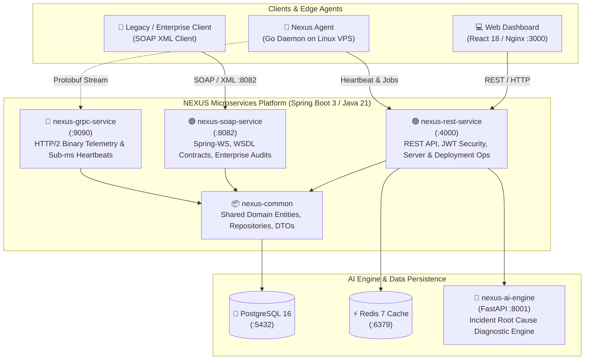
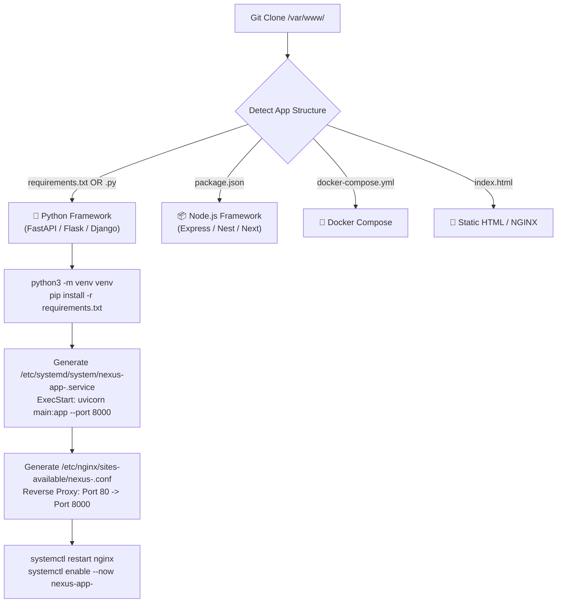

<div align="center">

# 🌐 NEXUS AI — Enterprise VPS & Infrastructure Management Platform

**AI-Driven Autonomous Linux Server Orchestration, Multi-Protocol Microservices & Telemetry Platform**

[](https://www.docker.com/)
[](https://spring.io/projects/spring-boot)
[](https://openjdk.org/)
[](https://go.dev/)
[](https://react.dev/)
[](https://fastapi.tiangolo.com/)
[](https://www.postgresql.org/)
[](https://redis.io/)

</div>

---

## 📋 Table of Contents
- [Overview](#-overview)
- [System Architecture](#-system-architecture)
- [Microservices & Components](#-microservices--components)
- [Key Features](#-key-features)
- [Quick Start with Docker](#-quick-start-with-docker)
- [Service Endpoints & Testing](#-service-endpoints--testing)
- [Smart Framework Auto-Detection (Go Agent)](#-smart-framework-auto-detection-go-agent)
- [Security & Multi-Tenancy](#-security--multi-tenancy)
- [Directory Structure](#-directory-structure)

---

## 🌟 Overview

**NEXUS AI** is an enterprise-grade cloud control plane designed to monitor, remediate, and deploy applications across distributed Linux VPS fleets. Built with modern microservice design principles, NEXUS delivers:
- **Multi-Protocol Microservices (Spring Boot 3 + Java 21):** Exposes simultaneous **REST**, **SOAP (Spring-WS)**, and **gRPC (Protobuf)** interfaces.
- **Explainable AI Root Cause Diagnostics (FastAPI):** Automated inference pipeline that detects CPU throttling, memory leaks, disk exhaustion, and proposes human-in-the-loop action proposals.
- **Smart Zero-Config Deployments:** The lightweight remote agent auto-inspects repository structure (FastAPI, Flask, Node.js, Compose), binds systemd services, and provisions NGINX reverse proxies.
- **Real-Time Operational Dashboard:** High-performance React 18 + TailwindCSS console served via Alpine NGINX.

---

## 🏗️ System Architecture



---

## 🧩 Microservices & Components

| Container Name | Technology | Port(s) | Description |
| :--- | :--- | :--- | :--- |
| **`nexus-dashboard`** | React 18, Vite, Nginx | `3000` | Administrative UI console with real-time analytics, 1-click update, and modal workflows. |
| **`nexus-rest-service`** | Spring Boot 3.3, Java 21 | `4000` | Core REST API with Spring Security 6, JJWT authentication, and deployment orchestration. |
| **`nexus-soap-service`** | Spring-WS, WSDL4J | `8082` | Enterprise SOAP Web Service exposing `/ws/servers.wsdl` for legacy automation. |
| **`nexus-grpc-service`** | gRPC, Protobuf, Netty | `9090`, `8083` | High-throughput binary RPC service for agent telemetry streaming. |
| **`nexus-ai-engine`** | Python 3.11, FastAPI, Uvicorn | `8001` | Explanatory AI reasoning engine generating root cause diagnostics and mitigation proposals. |
| **`nexus-postgres`** | PostgreSQL 16 | `5432` | Relational database with strict multi-tenant foreign keys and indexes. |
| **`nexus-redis`** | Redis 7 Alpine | `6379` | In-memory cache, rate limiting, and real-time state pub/sub. |

---

## ⚡ Quick Start with Docker

### 1. Clone & Setup
```bash
git clone https://github.com/Rafaaa4/vps_controller.git
cd vps_controller
```

### 2. Launch Entire Platform (1-Click)
Start all 7 containers directly with Docker Compose:
```bash
docker compose up -d
```

### 3. Verify Health
```bash
docker compose ps
```

All 7 containers will display status `Up` / `Healthy`:
```text
NAME                 IMAGE                                STATUS                   PORTS
nexus-ai-engine      vps_controller-ai-engine             Up (healthy)             0.0.0.0:8001->8001/tcp
nexus-dashboard      vps_controller-dashboard             Up                       0.0.0.0:3000->3000/tcp
nexus-grpc-service   vps_controller-spring-grpc-service   Up                       0.0.0.0:8083->8083/tcp, 0.0.0.0:9090->9090/tcp
nexus-postgres       postgres:16                          Up (healthy)             0.0.0.0:5432->5432/tcp
nexus-redis          redis:7-alpine                       Up (healthy)             0.0.0.0:6379->6379/tcp
nexus-rest-service   vps_controller-spring-rest-service   Up                       0.0.0.0:4000->4000/tcp
nexus-soap-service   vps_controller-spring-soap-service   Up                       0.0.0.0:8082->8082/tcp
```

Open your browser at **`http://localhost:3000`** to access the NEXUS Dashboard!

---

## 📡 Service Endpoints & Testing

### 1. REST API (`http://localhost:4000`)
```bash
# List all managed servers
curl -s http://localhost:4000/api/v1/servers | jq

# Download the standalone Linux agent binary
curl -s -I http://localhost:4000/agent/nexus-agent
```

### 2. SOAP Web Service (`http://localhost:8082`)
Inspect the generated WSDL contract:
```bash
curl -s http://localhost:8082/ws/servers.wsdl
```

Send a sample SOAP XML request:
```bash
curl -X POST http://localhost:8082/ws \
  -H "Content-Type: text/xml" \
  -d @- << 'EOF'
<soapenv:Envelope xmlns:soapenv="http://schemas.xmlsoap.org/soap/envelope/"
                  xmlns:sch="http://nexus.com/soap/servers">
   <soapenv:Header/>
   <soapenv:Body>
      <sch:GetServerStatusRequest>
         <sch:serverId>2c425709-e204-49ed-8e71-9a725135ec21</sch:serverId>
      </sch:GetServerStatusRequest>
   </soapenv:Body>
</soapenv:Envelope>
EOF
```

### 3. gRPC High-Throughput Service (`localhost:9090`)
Inspect services via `grpcurl`:
```bash
grpcurl -plaintext localhost:9090 list
```

### 4. AI Diagnostic Engine (`http://localhost:8001`)
```bash
curl -s http://localhost:8001/health | jq
```

---

## 🤖 Smart Framework Auto-Detection (Go Agent)

The **NEXUS Agent** (`agent/nexus-agent`) runs autonomously as a `systemd` daemon on managed remote hosts. When a deployment task is received, it executes intelligent framework inspection:



---

## 🔒 Security & Multi-Tenancy

1. **Strict Multi-Tenant Scoping:** All operations, metrics, incidents, and jobs require an active `organization_id` header or token context.
2. **Deterministic Agent Authentication:** Agents authenticate using SHA-256 secret hashes enrolled through 15-minute one-time tokens.
3. **Human-in-the-Loop AI Guardrails:** The AI diagnostic engine has **zero unattended execution rights**. Remediations must be produced as cryptographic `action_proposals` and explicitly approved by an operator via the dashboard.
4. **Dynamic IP Adaptation:** The agent bootstrap script and platform URLs resolve hostnames dynamically (`window.location.hostname`), avoiding hardcoded static IP breakage in dynamic DHCP/VPS environments.

---

## 📂 Directory Structure

```text
vps_controller/
├── dashboard/                     # React 18 + Vite Frontend Application
│   ├── Dockerfile                 # Multi-stage production NGINX runner
│   ├── nginx.conf                 # Reverse proxy for API & WebSockets
│   └── src/                       # React Views, Modals & Components
├── services/
│   ├── ai-engine/                 # Python 3.11 FastAPI Diagnostic Service
│   │   ├── Dockerfile
│   │   └── app/main.py            # AI root cause inference rules & endpoints
│   └── nexus-backend/             # Spring Boot 3 Multi-Module Platform
│       ├── pom.xml                # Parent Reactor POM
│       ├── nexus-common/          # JPA Entities, Repositories & DTOs
│       ├── nexus-rest-service/    # REST API Microservice (Port 4000)
│       ├── nexus-soap-service/    # SOAP Spring-WS Microservice (Port 8082)
│       └── nexus-grpc-service/    # gRPC Protobuf Microservice (Port 9090)
├── agent/                         # Autonomous Remote Go Agent
│   ├── dist/nexus-agent           # Compiled binary served via REST API
│   └── nexus-agent/               # Go source code (metrics, collector, executor)
├── infrastructure/
│   └── init.sql                   # Clean PostgreSQL 16 schema & seed data
├── packages/
│   └── shared-types/              # Shared TypeScript interfaces
├── docker-compose.yml             # Complete 7-container Docker orchestration
└── README.md                      # Platform documentation
```

---

## 👥 Authors & License

Developed with ❤️ by **[Rafaaa4](https://github.com/Rafaaa4)**.  
Licensed under the **MIT License**.
