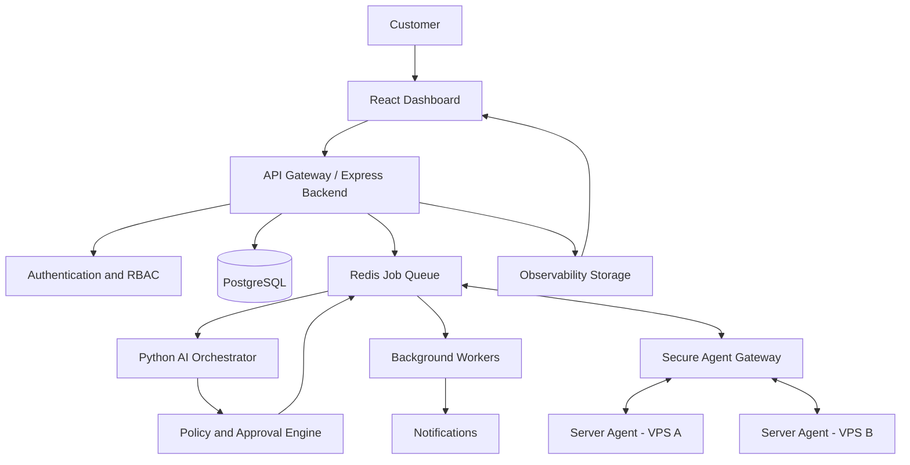
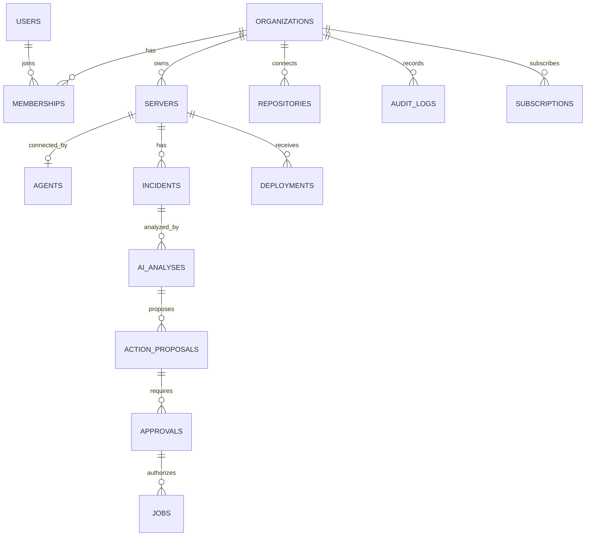
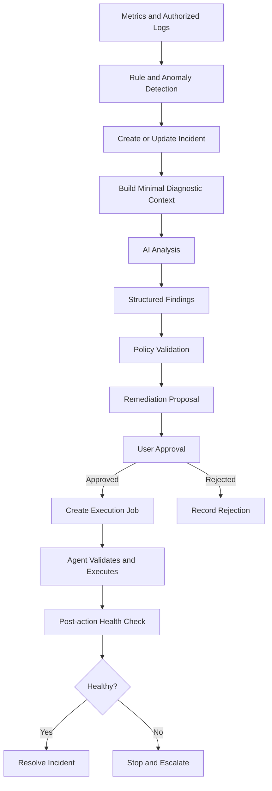
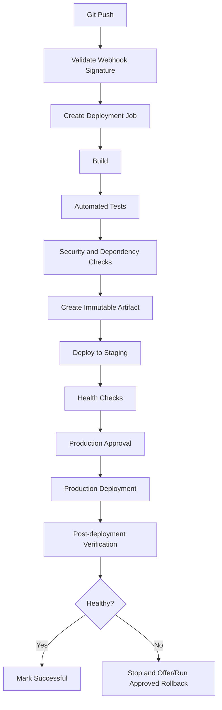

 NEXUS AI — Complete Technical Architecture & Development Plan

**Project type:** AI-powered VPS and server management SaaS  
**Architecture:** Multi-tenant SaaS with secure server agents  
**Initial server scope:** Linux VPS from any hosting provider  
**AI autonomy:** Approval required before executing remediation actions  
**Business model:** SaaS  
**Document status:** Technical blueprint and implementation roadmap  
**Version:** 1.0  
**Date:** 17 November 2026

---

## 1. Product Vision

NEXUS AI is a Software-as-a-Service platform that lets individuals and teams connect, monitor, manage, and deploy applications on their own Linux VPS servers, regardless of hosting provider.

Each customer can:

- Create an account and organization.
- Connect one or more Linux VPS servers.
- Monitor CPU, memory, disk, network, uptime, and services.
- Collect and search authorized server/application logs.
- Receive alerts and incident reports.
- Ask an AI DevOps assistant to investigate issues.
- Review AI-generated remediation proposals.
- Approve or reject proposed operations.
- Connect Git repositories and manage application deployments.
- Review deployment history and request rollbacks.

### Core product principle

The AI may investigate and propose actions, but **must not execute a remediation action until an authorized user approves the exact proposal**. Approval is bound to the server, action, parameters, and expiry time. Any change to the proposal invalidates the approval.

---

## 2. Product Scope

### 2.1 Initial supported environments

Start with Linux VPS environments:

- Ubuntu 22.04 and 24.04.
- Debian 12 and 13.
- `amd64` and `arm64` where supported and tested.

Potential later support:

- Rocky Linux.
- AlmaLinux.
- Fedora Server.
- Windows Server, as a separate future agent implementation.

“Any VPS provider” means any provider that gives the customer a supported Linux machine with outbound network connectivity and sufficient permissions to install the agent. Provider-specific APIs are not required for the first release.

### 2.2 MVP features

1. Account registration and login.
2. Organizations and team membership.
3. Role-based access control.
4. Server registration and agent enrollment.
5. Secure agent-to-platform communication.
6. CPU, RAM, disk, network, uptime metrics.
7. Service status monitoring.
8. Authorized log collection and viewing.
9. Incident detection and alerting.
10. AI analysis and remediation proposals.
11. Approval and rejection workflow.
12. Audit trail for sensitive actions.

### 2.3 Later features

- Controlled remediation execution.
- Docker/container management.
- GitHub integration.
- CI/CD build and deployment.
- Staging and production environments.
- Health checks and rollback.
- Security posture analysis.
- Subscription billing and usage limits.
- Multi-region infrastructure and large-scale ingestion.

---

## 3. High-Level Architecture



### Main components

| Component | Responsibility | Suggested technology |
|---|---|---|
| Dashboard | Customer interface | React, Vite, TypeScript |
| API | Business logic and API | Node.js, Express, TypeScript |
| Database | Accounts and operational metadata | PostgreSQL |
| ORM | Database access | Prisma, plus SQL migrations for RLS |
| Queue | Asynchronous jobs | Redis and BullMQ |
| AI Engine | Diagnosis and proposal generation | Python and FastAPI |
| Server Agent | Local collection and approved operations | Go |
| Metrics | Time-series monitoring | Prometheus-compatible storage |
| Logs | Centralized log storage | Grafana Loki |
| Telemetry | Collection and transport | OpenTelemetry |
| Containers | Packaging and local deployment | Docker |
| Reverse proxy | TLS termination and routing | Nginx |
| CI/CD | Build and test automation | GitHub Actions initially |
| Object storage | Artifacts and backup objects | S3-compatible storage |

### Architecture decision

Start with a **modular monolith** for the main Express API. Keep the Go agent and Python AI engine as separate processes/services. Split more backend modules into independent services only when scale or team boundaries justify it.

Do not introduce Kubernetes in the first development stage. Docker Compose is sufficient for local development and an initial controlled deployment.

---

## 4. Multi-Tenant SaaS Design

NEXUS AI must isolate each customer's resources.

### Core rules

- A user belongs to one or more organizations through memberships.
- An organization owns its servers, agents, incidents, jobs, proposals, deployments, and subscription.
- Every tenant-owned record includes an `organization_id`.
- The API derives tenant access from the authenticated user's membership.
- Never trust an `organization_id` supplied by the browser without checking membership.
- Apply PostgreSQL Row-Level Security (RLS) as an additional database protection layer.
- Use composite foreign keys where appropriate to prevent records from referencing resources belonging to another tenant.
- Add automated cross-tenant access tests for every resource endpoint.

### Roles

| Role | Permissions |
|---|---|
| Owner | Full organization control, billing, members, servers |
| Admin | Manage members and servers, subject to policy |
| Operator | View and operate permitted server resources |
| Viewer | Read-only access |

Sensitive actions should have explicit permissions in addition to broad roles. For example, viewing logs, approving remediation, managing integrations, and deploying to production may be separate permissions.

---

## 5. Repository / Monorepo Structure

```text
nexus-ai/
├── apps/
│   ├── dashboard/
│   │   ├── src/
│   │   │   ├── components/
│   │   │   ├── pages/
│   │   │   ├── layouts/
│   │   │   ├── services/
│   │   │   ├── hooks/
│   │   │   └── store/
│   │   └── package.json
│   └── api/
│       ├── src/
│       │   ├── modules/
│       │   │   ├── auth/
│       │   │   ├── organizations/
│       │   │   ├── memberships/
│       │   │   ├── servers/
│       │   │   ├── agents/
│       │   │   ├── monitoring/
│       │   │   ├── logs/
│       │   │   ├── incidents/
│       │   │   ├── approvals/
│       │   │   ├── jobs/
│       │   │   ├── deployments/
│       │   │   ├── integrations/
│       │   │   ├── notifications/
│       │   │   ├── billing/
│       │   │   └── audit/
│       │   ├── middleware/
│       │   ├── queues/
│       │   ├── config/
│       │   └── app.ts
│       └── package.json
├── services/
│   ├── ai-engine/
│   │   ├── app/
│   │   │   ├── orchestrator/
│   │   │   ├── agents/
│   │   │   ├── tools/
│   │   │   ├── diagnostics/
│   │   │   ├── policies/
│   │   │   └── schemas/
│   │   └── pyproject.toml
│   ├── workers/
│   └── notifications/
├── agent/
│   └── nexus-agent/
│       ├── cmd/
│       ├── internal/
│       │   ├── collector/
│       │   ├── transport/
│       │   ├── executor/
│       │   ├── services/
│       │   └── security/
│       └── go.mod
├── packages/
│   ├── shared-types/
│   └── api-contracts/
├── infrastructure/
│   ├── docker/
│   ├── monitoring/
│   ├── migrations/
│   └── deployment/
├── docs/
├── docker-compose.yml
└── README.md
```

---

## 6. Database Architecture

Use PostgreSQL for transactional and relational data. Do not store high-volume metrics and raw logs indefinitely in ordinary relational tables.

### 6.1 Core entities

| Table | Purpose |
|---|---|
| `users` | User accounts |
| `organizations` | SaaS tenants |
| `memberships` | User-to-organization roles |
| `servers` | Connected VPS inventory |
| `agents` | Agent identity and status |
| `agent_enrollment_tokens` | Short-lived one-time enrollment |
| `server_metrics` | Optional summarized metrics |
| `alert_rules` | Customer alert configuration |
| `incidents` | Detected problems |
| `ai_analyses` | AI diagnostic results |
| `action_proposals` | Proposed operations |
| `approvals` | User decisions |
| `jobs` | Agent and background jobs |
| `deployments` | Deployment records |
| `repositories` | Connected code repositories |
| `environments` | Staging and production targets |
| `integrations` | External service connections |
| `audit_logs` | Security and activity history |
| `subscriptions` | Plan and billing state |
| `usage_records` | Usage metering |

### 6.2 Relationship model



### 6.3 Starter SQL schema

This is a starting schema, not the complete production migration set. Add constraints, RLS policies, retention rules, and tests before production.

```sql
CREATE EXTENSION IF NOT EXISTS pgcrypto;

CREATE TABLE users (
    id UUID PRIMARY KEY DEFAULT gen_random_uuid(),
    email VARCHAR(255) UNIQUE NOT NULL,
    password_hash TEXT NOT NULL,
    full_name VARCHAR(150),
    email_verified BOOLEAN NOT NULL DEFAULT FALSE,
    created_at TIMESTAMPTZ NOT NULL DEFAULT NOW()
);

CREATE TABLE organizations (
    id UUID PRIMARY KEY DEFAULT gen_random_uuid(),
    name VARCHAR(150) NOT NULL,
    slug VARCHAR(100) UNIQUE NOT NULL,
    created_at TIMESTAMPTZ NOT NULL DEFAULT NOW()
);

CREATE TABLE memberships (
    organization_id UUID NOT NULL REFERENCES organizations(id),
    user_id UUID NOT NULL REFERENCES users(id),
    role VARCHAR(30) NOT NULL
        CHECK (role IN ('owner', 'admin', 'operator', 'viewer')),
    created_at TIMESTAMPTZ NOT NULL DEFAULT NOW(),
    PRIMARY KEY (organization_id, user_id)
);

CREATE TABLE servers (
    id UUID PRIMARY KEY DEFAULT gen_random_uuid(),
    organization_id UUID NOT NULL REFERENCES organizations(id),
    name VARCHAR(150) NOT NULL,
    hostname VARCHAR(255),
    provider VARCHAR(100),
    os_name VARCHAR(100),
    os_version VARCHAR(100),
    architecture VARCHAR(50),
    status VARCHAR(30) NOT NULL DEFAULT 'pending',
    created_at TIMESTAMPTZ NOT NULL DEFAULT NOW(),
    UNIQUE (organization_id, id)
);

CREATE TABLE agents (
    id UUID PRIMARY KEY DEFAULT gen_random_uuid(),
    organization_id UUID NOT NULL,
    server_id UUID NOT NULL,
    version VARCHAR(50),
    public_key TEXT,
    status VARCHAR(30) NOT NULL DEFAULT 'offline',
    last_seen_at TIMESTAMPTZ,
    enrolled_at TIMESTAMPTZ NOT NULL DEFAULT NOW(),
    FOREIGN KEY (organization_id, server_id)
        REFERENCES servers(organization_id, id),
    UNIQUE (server_id)
);

CREATE TABLE incidents (
    id UUID PRIMARY KEY DEFAULT gen_random_uuid(),
    organization_id UUID NOT NULL,
    server_id UUID NOT NULL,
    title TEXT NOT NULL,
    description TEXT,
    severity VARCHAR(20) NOT NULL,
    status VARCHAR(30) NOT NULL DEFAULT 'open',
    detected_at TIMESTAMPTZ NOT NULL DEFAULT NOW(),
    resolved_at TIMESTAMPTZ,
    FOREIGN KEY (organization_id, server_id)
        REFERENCES servers(organization_id, id)
);

CREATE TABLE ai_analyses (
    id UUID PRIMARY KEY DEFAULT gen_random_uuid(),
    organization_id UUID NOT NULL,
    incident_id UUID NOT NULL REFERENCES incidents(id),
    model_name VARCHAR(100),
    root_cause TEXT,
    confidence NUMERIC(5,4),
    recommendations JSONB,
    created_at TIMESTAMPTZ NOT NULL DEFAULT NOW()
);

CREATE TABLE action_proposals (
    id UUID PRIMARY KEY DEFAULT gen_random_uuid(),
    organization_id UUID NOT NULL,
    server_id UUID NOT NULL,
    analysis_id UUID REFERENCES ai_analyses(id),
    action_type VARCHAR(100) NOT NULL,
    parameters JSONB NOT NULL,
    risk_level VARCHAR(20) NOT NULL,
    status VARCHAR(30) NOT NULL DEFAULT 'pending',
    proposal_hash TEXT NOT NULL,
    expires_at TIMESTAMPTZ,
    created_at TIMESTAMPTZ NOT NULL DEFAULT NOW(),
    FOREIGN KEY (organization_id, server_id)
        REFERENCES servers(organization_id, id)
);

CREATE TABLE approvals (
    id UUID PRIMARY KEY DEFAULT gen_random_uuid(),
    organization_id UUID NOT NULL,
    proposal_id UUID NOT NULL REFERENCES action_proposals(id),
    approved_by UUID REFERENCES users(id),
    decision VARCHAR(20) NOT NULL
        CHECK (decision IN ('approved', 'rejected')),
    proposal_hash TEXT NOT NULL,
    decided_at TIMESTAMPTZ NOT NULL DEFAULT NOW()
);

CREATE TABLE jobs (
    id UUID PRIMARY KEY DEFAULT gen_random_uuid(),
    organization_id UUID NOT NULL,
    server_id UUID NOT NULL,
    proposal_id UUID REFERENCES action_proposals(id),
    job_type VARCHAR(100) NOT NULL,
    status VARCHAR(30) NOT NULL DEFAULT 'queued',
    idempotency_key TEXT UNIQUE,
    result JSONB,
    created_at TIMESTAMPTZ NOT NULL DEFAULT NOW(),
    finished_at TIMESTAMPTZ,
    FOREIGN KEY (organization_id, server_id)
        REFERENCES servers(organization_id, id)
);

CREATE TABLE deployments (
    id UUID PRIMARY KEY DEFAULT gen_random_uuid(),
    organization_id UUID NOT NULL,
    server_id UUID NOT NULL,
    repository_id UUID,
    commit_sha VARCHAR(100),
    environment VARCHAR(50),
    status VARCHAR(30) NOT NULL DEFAULT 'pending',
    created_at TIMESTAMPTZ NOT NULL DEFAULT NOW(),
    FOREIGN KEY (organization_id, server_id)
        REFERENCES servers(organization_id, id)
);

CREATE TABLE audit_logs (
    id UUID PRIMARY KEY DEFAULT gen_random_uuid(),
    organization_id UUID NOT NULL,
    actor_id UUID,
    action VARCHAR(150) NOT NULL,
    resource_type VARCHAR(100),
    resource_id UUID,
    metadata JSONB,
    created_at TIMESTAMPTZ NOT NULL DEFAULT NOW()
);

CREATE INDEX idx_servers_org ON servers(organization_id);
CREATE INDEX idx_incidents_org_time
    ON incidents(organization_id, detected_at DESC);
CREATE INDEX idx_jobs_status_time
    ON jobs(status, created_at);
CREATE INDEX idx_audit_org_time
    ON audit_logs(organization_id, created_at DESC);
```

### 6.4 Additional production requirements

- Add tables for refresh-token sessions, password reset, email verification, API credentials, agent enrollment, agent certificates, alert rules, notification preferences, repository installations, environments, deployment artifacts, billing events, and usage records.
- Add `organization_id` to every tenant-owned record.
- Apply RLS policies to tenant-owned tables.
- Use a non-owner application database role that cannot bypass RLS.
- Set the tenant context transaction-locally and safely.
- Test that cross-tenant reads, writes, updates, and deletes are denied.
- Encrypt integration tokens and other secrets using a dedicated secrets manager or envelope encryption.
- Define data retention and deletion policies.

### 6.5 Storage allocation

| Data | Storage |
|---|---|
| Accounts, servers, approvals | PostgreSQL |
| Time-series metrics | Prometheus-compatible TSDB |
| Logs | Loki |
| Cache and queues | Redis |
| Build artifacts and backups | S3-compatible object storage |
| Secrets | Dedicated secrets manager |

---

## 7. Backend API Design

All public API routes use `/api/v1`.

### 7.1 Authentication

| Method | Endpoint | Purpose |
|---|---|---|
| POST | `/auth/register` | Create account |
| POST | `/auth/login` | Login |
| POST | `/auth/refresh` | Rotate refresh token |
| POST | `/auth/logout` | Revoke session |
| GET | `/auth/me` | Current user |

Use secure password hashing, short-lived access tokens, refresh-token rotation, session revocation, rate limiting, and email verification.

### 7.2 Organizations and members

| Method | Endpoint | Purpose |
|---|---|---|
| GET | `/organizations` | List memberships |
| POST | `/organizations` | Create organization |
| GET | `/organizations/:id` | Organization details |
| GET | `/organizations/:id/members` | List members |
| POST | `/organizations/:id/invitations` | Invite member |
| PATCH | `/organizations/:id/members/:userId` | Change role |
| DELETE | `/organizations/:id/members/:userId` | Remove member |

### 7.3 Servers and agents

| Method | Endpoint | Purpose |
|---|---|---|
| GET | `/servers` | List authorized servers |
| POST | `/servers` | Create server record |
| GET | `/servers/:id` | Server details |
| DELETE | `/servers/:id` | Disconnect server |
| POST | `/servers/:id/enrollment-token` | Create one-time enrollment |
| GET | `/servers/:id/metrics` | Query metrics |
| GET | `/servers/:id/services` | Service status |
| GET | `/servers/:id/logs` | Query authorized logs |

Agent-specific routes should use a separate authentication mechanism and namespace, for example `/agent/v1/...`. Do not authenticate agents with ordinary user JWTs.

### 7.4 Incidents and AI

| Method | Endpoint | Purpose |
|---|---|---|
| GET | `/incidents` | List incidents |
| GET | `/incidents/:id` | Incident details |
| POST | `/ai/analyze/:serverId` | Request analysis |
| GET | `/ai/analyses/:id` | Analysis details |
| GET | `/ai/proposals` | List proposals |
| POST | `/ai/proposals/:id/approve` | Approve exact proposal |
| POST | `/ai/proposals/:id/reject` | Reject proposal |

### 7.5 Jobs and deployments

| Method | Endpoint | Purpose |
|---|---|---|
| GET | `/jobs` | Job history |
| GET | `/jobs/:id` | Job details |
| POST | `/jobs/:id/cancel` | Cancel eligible pending job |
| POST | `/integrations/github` | Connect GitHub |
| POST | `/webhooks/github` | Receive validated webhook |
| GET | `/deployments` | Deployment history |
| POST | `/deployments` | Start deployment |
| POST | `/deployments/:id/rollback` | Request rollback |

### 7.6 API request controls

Every protected endpoint must perform:

1. Authentication.
2. Tenant resolution from trusted identity.
3. Membership and role authorization.
4. Resource ownership validation.
5. Input schema validation.
6. Rate limiting and abuse controls.
7. Audit logging for sensitive operations.
8. Consistent error handling.

Use OpenAPI to document the API and generate shared types where practical.

---

## 8. Server Agent Architecture

The NEXUS Agent is a small Go service installed on each customer VPS.

### 8.1 Agent modules

| Module | Responsibility |
|---|---|
| Metrics Collector | CPU, RAM, disk, network, uptime |
| Logs Collector | Customer-selected application/system logs |
| Service Monitor | Status of approved services |
| Transport | Secure communication with platform |
| Identity | Agent key and certificate handling |
| Policy Executor | Executes only predefined, authorized operation types |
| Health Reporter | Agent health and last successful collection |

### 8.2 Communication model

Use outbound-only agent connections where possible. The VPS initiates a TLS connection to the platform; the platform does not need to expose SSH or a general-purpose remote shell.

Recommended controls:

- Mutual TLS or equivalent strong per-agent identity.
- One-time, short-lived enrollment tokens.
- Per-agent certificate and revocation.
- Signed or authenticated messages.
- Request IDs and idempotency keys.
- Expiring jobs.
- Replay protection.
- Heartbeats.
- Retry with exponential backoff.
- Strict message schemas and size limits.
- Tenant and server binding verified on every message.

### 8.3 Agent privileges

- Run collectors with the minimum permissions needed.
- Separate the collector process from the privileged execution helper.
- Keep the privileged helper small and narrowly scoped.
- Use a fixed allowlist of typed operations.
- Never expose arbitrary shell execution to the AI.
- Do not expose the Docker socket to the public network.
- Do not store provider passwords or unrestricted root credentials in the platform.
- Log all privileged operations locally and centrally where appropriate.

### 8.4 Example typed operation envelope

This is a message schema illustration, not a shell command:

```json
{
  "job_id": "job-uuid",
  "server_id": "server-uuid",
  "operation": "service.restart",
  "target": "approved-service-name",
  "proposal_id": "proposal-uuid",
  "approval_id": "approval-uuid",
  "proposal_hash": "sha256-of-approved-proposal",
  "expires_at": "2026-11-17T12:00:00Z"
}
```

The agent must validate the operation type, target allowlist, expiry, signature, server identity, approval binding, and replay/idempotency state before execution.

---

## 9. AI Orchestration Architecture

The AI engine is a separate Python service, exposed internally through FastAPI or a queue-driven worker interface.

### 9.1 AI roles

| Role / workflow | Responsibility |
|---|---|
| Monitoring Analyzer | Interpret metrics and anomalies |
| Log Analyzer | Correlate log events |
| Security Analyzer | Identify security concerns |
| DevOps Assistant | Explain infrastructure state |
| Code Analyzer | Review application changes and errors |
| Database Analyzer | Diagnose database performance signals |

These do not need to be separate LLMs. Start with one model and separate workflows, tool permissions, prompts, schemas, and policy checks.

### 9.2 Analysis pipeline



### 9.3 AI context

Provide only the information required for the current task:

- Server ID and operating-system metadata.
- Relevant metric window.
- Relevant, redacted log excerpts.
- Service state.
- Recent deployments and configuration changes.
- Related incidents.
- Available diagnostic results.

Do not send unrelated customer data or other tenants' information to the model.

### 9.4 Structured AI output

Require schema-validated output, for example:

```json
{
  "incident_id": "incident-uuid",
  "summary": "Possible application resource issue",
  "root_cause_hypotheses": [
    {
      "description": "Recent application change may be related",
      "confidence": 0.72,
      "evidence": ["metric-window-id", "deployment-event-id"]
    }
  ],
  "severity": "warning",
  "recommendations": [
    {
      "type": "diagnostic",
      "description": "Inspect the relevant application workload"
    }
  ],
  "requires_approval": true
}
```

Confidence scores are model estimates, not proof. Show supporting evidence and uncertainty to the user.

### 9.5 Tool registry

Start with read-only tools:

- `get_server_metrics`
- `get_service_status`
- `search_authorized_logs`
- `inspect_disk_usage`
- `get_recent_deployments`
- `get_incident_history`
- `analyze_deployment`

Proposal tools:

- `create_action_proposal`
- `request_deployment_approval`
- `request_rollback_approval`

Execution tools must not be directly available to the LLM. The execution service accepts only an approved, unexpired, unchanged proposal.

### 9.6 Approval controls

Each approval must:

- Refer to one proposal and one server.
- Bind to a cryptographic hash of the exact action and parameters.
- Expire after a defined period.
- Be single-use.
- Record the approving user and timestamp.
- Be invalidated if the proposal changes.
- Be checked again immediately before execution.
- Be rejected if the user no longer has the required permission.

For high-risk or destructive operations, require additional confirmation or disallow automated execution entirely.

### 9.7 Monitoring cadence

Suggested starting configuration, adjustable per plan:

| Task | Example cadence |
|---|---|
| Agent heartbeat | 30–60 seconds |
| Basic metrics | 15–30 seconds |
| Rule-based alert checks | Continuous/event-driven |
| Anomaly analysis | On relevant signal |
| AI diagnosis | On incident or user request |
| Daily report | Once per day |

Do not invoke an LLM for every metric sample. Use inexpensive deterministic rules for continuous monitoring and invoke AI when context-based diagnosis is useful.

---

## 10. Monitoring and Logs

### Suggested stack

- Prometheus-compatible metrics backend for time-series data.
- Grafana Loki for logs.
- OpenTelemetry Collector for telemetry pipelines.
- Grafana for internal operations dashboards.
- NEXUS UI for customer-facing views.

### Metrics

- CPU utilization.
- Memory utilization.
- Disk capacity and I/O.
- Network throughput and errors.
- Load average.
- Uptime.
- Selected service health.

### Logs

- Customer-selected system logs.
- Selected application logs.
- Deployment logs.
- Agent logs.
- NEXUS job and audit events.

### Log safeguards

- Redact passwords, tokens, private keys, and common secret patterns before transmission.
- Limit collection to paths and sources explicitly configured by the customer.
- Enforce retention and deletion policies.
- Restrict log access by tenant and role.
- Prevent customer-controlled labels or headers from overriding trusted tenant identity.
- Limit query size and rate to protect the log backend.

---

## 11. CI/CD and Deployment Engine

The first deployment path should use containerized applications to reduce differences between distributions and VPS providers.

### 11.1 Deployment pipeline



### 11.2 Initial supported workloads

| Workload | Initial deployment approach |
|---|---|
| Node.js | Docker image |
| React | Static build served by web server/container |
| PHP | Docker image with PHP runtime |
| Python | Docker image |
| Spring Boot | Docker image |
| MySQL/PostgreSQL | Prefer managed or separately maintained database; container use requires explicit data/backup design |

### 11.3 Repository integration

Store:

- Provider and repository ID.
- Organization owner.
- Selected branch.
- Webhook ID and status.
- Deployment configuration.
- Environment mapping.
- Encrypted integration credentials.

Webhook security:

- Validate provider signatures.
- Prevent replay.
- Restrict repository and branch.
- Validate payload size and schema.
- Never execute arbitrary instructions from untrusted webhook fields.

### 11.4 Deployment history and rollback

Record:

- Commit SHA.
- Build artifact digest.
- Previous and current release.
- Environment.
- Configuration version reference.
- Deployment logs.
- Health-check results.
- Approval record.
- Rollback event.

Database migrations require a separate compatibility and recovery strategy. Do not assume that reverting an application image safely reverses database changes.

---

## 12. SaaS Infrastructure and Scaling

### Initial deployment

A small controlled environment can begin with:

- Nginx reverse proxy.
- Express API.
- Python AI worker.
- Background worker.
- PostgreSQL.
- Redis.
- Metrics and logs storage.
- Object storage.

Use Docker Compose for development and early staging. Keep production secrets outside source control and use managed database/storage services where practical.

### Queue examples

- `metrics.ingest`
- `logs.ingest`
- `incident.detect`
- `ai.analyze`
- `proposal.create`
- `action.execute`
- `deployment.build`
- `deployment.deploy`
- `notification.send`

Each job should include:

- Job ID.
- Organization ID.
- Server ID where relevant.
- Job type.
- Priority.
- Timeout.
- Retry policy.
- Idempotency key.
- Status and result reference.

### Scaling stages

1. One application environment for development.
2. Separate database, API, and workers.
3. Multiple API instances and dedicated AI workers.
4. Horizontally scaled telemetry ingestion.
5. Separate log and metrics storage capacity.
6. Regional infrastructure if customer distribution and scale require it.

### Cost controls

- Per-plan server limits.
- Metrics sampling and retention tiers.
- Log ingestion quotas.
- AI token and request budgets.
- Per-tenant queue limits.
- Rate limiting.
- Usage metering and alerts.

---

## 13. Frontend Dashboard

### Main pages

| Page | Features |
|---|---|
| Overview | Server count, status, incidents, usage |
| My Servers | Connected VPS inventory |
| Server Details | System info, metrics, services |
| Live Monitoring | CPU, RAM, disk, network |
| Logs Explorer | Search and filter authorized logs |
| AI Engineer | Infrastructure assistant |
| Incidents | Incident timeline and evidence |
| AI Proposals | Proposed remediations |
| Approvals | Pending user decisions |
| Deployments | Build and release history |
| Integrations | Git provider connections |
| Team | Organization members and roles |
| Billing | Subscription and usage |
| Settings | Security, notifications, retention |

### UI requirements

- Responsive desktop and mobile layouts.
- Clear server connection and health states.
- Incident severity labels.
- Explainable AI findings with evidence.
- Explicit approval screens showing exact action, target, impact, and rollback/recovery information.
- Live updates through WebSocket or Server-Sent Events.
- Accessible controls and clear error messages.

---

## 14. Security Architecture

Security is a foundational requirement because the platform manages customer infrastructure.

### 14.1 Identity and access

- Secure password hashing.
- Short-lived access tokens.
- Refresh-token rotation and revocation.
- Email verification.
- Optional MFA.
- RBAC and resource-level authorization.
- Session and API-key management.

### 14.2 Tenant isolation

- Organization scoping in every tenant-owned query.
- PostgreSQL RLS.
- Composite foreign keys where useful.
- Trusted tenant context.
- Automated cross-tenant integration tests.
- No tenant identifiers trusted solely from client input.

### 14.3 Agent security

- Per-agent identity.
- Short-lived enrollment token.
- Certificate revocation.
- Outbound authenticated communication.
- Strict protocol schemas.
- Least privilege.
- No unrestricted remote shell.
- No public Docker socket.
- Agent update signing and verification.

### 14.4 AI security

- Treat logs, code, issue descriptions, and server output as untrusted data.
- Defend against prompt injection in retrieved content.
- Keep tool permissions separate from model reasoning.
- Use deterministic policy checks.
- Require explicit approval.
- Revalidate authorization immediately before execution.
- Keep execution tools outside direct LLM control.
- Limit AI context to the correct tenant and server.

### 14.5 Data protection

- TLS in transit.
- Encryption at rest.
- Secrets manager or envelope encryption.
- Secret redaction in logs and prompts.
- Data retention and deletion.
- Backups with restore tests.
- Audit events protected against ordinary modification.

### 14.6 Incident response

Prepare procedures for:

- Compromised user account.
- Compromised agent.
- Leaked integration token.
- Cross-tenant access vulnerability.
- Malicious or incorrect AI proposal.
- Failed deployment.
- Database corruption.
- Telemetry/logging outage.

---

## 15. Development Roadmap

The following timeline is an estimate for planning. Actual duration depends on team size, experience, testing, and infrastructure.

### Phase 1 — SaaS Foundation (Weeks 1–2)

**Build:**

- Monorepo setup.
- React + Vite + TypeScript dashboard.
- Express + TypeScript API.
- PostgreSQL and Prisma.
- Authentication and session handling.
- Organizations and memberships.
- RBAC.
- Server CRUD.
- OpenAPI documentation.
- Docker Compose development environment.

**Acceptance criteria:**

- Users can register and log in.
- Users can create an organization.
- Organization members have correct roles.
- Cross-tenant access tests pass.
- Users can create and manage server records.

### Phase 2 — Server Agent (Weeks 3–4)

**Build:**

- Go agent skeleton.
- One-time enrollment.
- Agent identity and revocation.
- Secure outbound connection.
- Heartbeat.
- CPU/RAM/disk/network collection.
- Service status collection.
- Agent health reporting.

**Acceptance criteria:**

- A supported test VPS enrolls securely.
- The dashboard shows the correct server.
- Metrics update reliably.
- Revoked agents cannot reconnect.

### Phase 3 — Monitoring and Logs (Weeks 5–6)

**Build:**

- Metrics ingestion.
- Metrics storage.
- Authorized log collection.
- Secret redaction.
- Logs search.
- Alert rules.
- Incident lifecycle.
- Notifications.

**Acceptance criteria:**

- Customer sees only their own telemetry.
- Alert rules create incidents.
- Logs are redacted and retention-limited.
- Agent disconnects are detected.

### Phase 4 — AI Engineer (Weeks 7–9)

**Build:**

- Python AI service.
- Diagnostic context builder.
- Read-only tool registry.
- Metrics and log analysis.
- Structured AI outputs.
- Incident summaries.
- Remediation proposals.
- Approval UI and audit records.

**Acceptance criteria:**

- AI analysis includes evidence and uncertainty.
- AI cannot execute operations directly.
- Proposal approval is bound to exact parameters.
- Rejected or expired proposals cannot execute.

### Phase 5 — Controlled Operations and CI/CD (Weeks 10–12)

**Build:**

- Typed operation registry.
- Restricted agent executor.
- Approval-bound job execution.
- Post-operation verification.
- GitHub integration.
- Build and test pipeline.
- Staging deployment.
- Production approval.
- Deployment history and rollback workflow.

**Acceptance criteria:**

- Only approved typed actions execute.
- Duplicate jobs do not repeat operations.
- Job results are auditable.
- Failed deployments stop safely.
- Rollback is tested in a staging environment.

### Phase 6 — SaaS Production Readiness (Weeks 13–16+)

**Build:**

- Subscription plans.
- Usage metering.
- Billing integration.
- Rate and quota enforcement.
- Security testing.
- Backup and restore procedures.
- Monitoring for the NEXUS platform itself.
- Load testing.
- Documentation.
- Customer onboarding.

**Acceptance criteria:**

- Subscription limits are enforced.
- Backup restoration is tested.
- Tenant isolation tests pass.
- Security review is completed.
- Operational alerts and incident procedures exist.

---

## 16. Testing Strategy

### Backend

- Unit tests for business logic.
- API integration tests.
- Authentication and authorization tests.
- Tenant isolation tests.
- Database migration tests.
- Rate-limit tests.

### Agent

- Unit tests for collectors.
- Protocol and signature tests.
- Reconnection and retry tests.
- Expired/replayed job rejection tests.
- Permission-boundary tests.
- Supported distribution compatibility tests.

### AI

- Structured-output schema tests.
- Hallucination and uncertainty evaluations.
- Prompt-injection tests using hostile log/code samples.
- Tenant-context isolation tests.
- Tool permission tests.
- Proposal tampering tests.
- Approval expiry and revocation tests.

### Deployment

- Build reproducibility tests.
- Failed test pipeline tests.
- Staging verification.
- Production approval tests.
- Rollback tests.
- Database migration compatibility tests.

### End-to-end

Test at least two separate organizations with separate VPS agents. Verify that neither organization can access the other's servers, metrics, logs, incidents, AI context, jobs, or deployments.

---

## 17. Initial Product Metrics

Track product reliability and operational quality:

- Agent connection success rate.
- Metrics ingestion delay.
- Log ingestion delay.
- Incident detection delay.
- AI analysis latency.
- Percentage of AI findings with supporting evidence.
- Proposal approval/rejection rate.
- Job success/failure rate.
- Deployment success rate.
- Rollback success rate.
- Cross-tenant authorization test results.
- Cost per active server.
- AI cost per organization.

Do not optimize for the number of automatic fixes. Optimize for safe, correct, explainable outcomes.

---

## 18. Key Technical Decisions

| Area | Decision |
|---|---|
| Product | Multi-tenant SaaS |
| Initial server scope | Supported Linux VPS from any provider |
| Main frontend | React + Vite + TypeScript |
| Main API | Node.js + Express + TypeScript |
| AI service | Python + FastAPI/workers |
| Agent | Go |
| Database | PostgreSQL |
| ORM | Prisma, with SQL migrations for RLS |
| Queue | Redis + BullMQ |
| Metrics | Prometheus-compatible storage |
| Logs | Grafana Loki |
| Telemetry | OpenTelemetry |
| Containers | Docker |
| Reverse proxy | Nginx |
| API specification | OpenAPI |
| Testing | Vitest, Pytest, Go test |
| AI execution policy | Approval required |
| Initial deployment | Docker Compose |
| Scaling | Separate workers and storage, then horizontal scaling |

---

## 19. Recommended Implementation Order

Do not start by building all AI workflows or CI/CD features. First establish a secure and testable foundation.

Recommended order:

1. Create the monorepo.
2. Set up the dashboard and API.
3. Set up PostgreSQL and migrations.
4. Implement authentication and sessions.
5. Implement organizations, memberships, and RBAC.
6. Implement tenant isolation and automated tests.
7. Implement server records and agent enrollment.
8. Build the Go agent and secure communication.
9. Add metrics and service monitoring.
10. Add logs, redaction, and alerting.
11. Add incidents and AI read-only diagnosis.
12. Add proposals and approval workflow.
13. Add the restricted execution service.
14. Add GitHub integration and CI/CD.
15. Add billing, quotas, and production hardening.

### First milestone

The first practical milestone is:

**A user can create an account, create an organization, register a Linux VPS, install the NEXUS Agent, and see live server metrics in the dashboard—without giving the platform an unrestricted root password or public SSH access.**

Once that milestone is reliable and tenant-isolated, the AI and automation layers can be added safely.

---

## 20. Official Technical Documentation

- PostgreSQL Row Security: https://www.postgresql.org/docs/current/ddl-rowsecurity.html
- Prisma: https://www.prisma.io/docs
- Express: https://expressjs.com/
- React: https://react.dev/
- Go: https://go.dev/doc/
- FastAPI: https://fastapi.tiangolo.com/
- Redis: https://redis.io/docs/latest/
- BullMQ: https://docs.bullmq.io/
- OpenTelemetry Collector: https://opentelemetry.io/docs/collector/
- OpenTelemetry security: https://opentelemetry.io/docs/security/config-best-practices/
- Prometheus security: https://prometheus.io/docs/operating/security/
- Grafana Loki: https://grafana.com/docs/loki/latest/
- Loki multi-tenancy: https://grafana.com/docs/loki/latest/operations/multi-tenancy/
- Docker Engine security: https://docs.docker.com/engine/security/
- GitHub Actions: https://docs.github.com/en/actions

---

**NEXUS AI — Build the secure infrastructure foundation first, then add explainable AI operations and controlled automation.**
